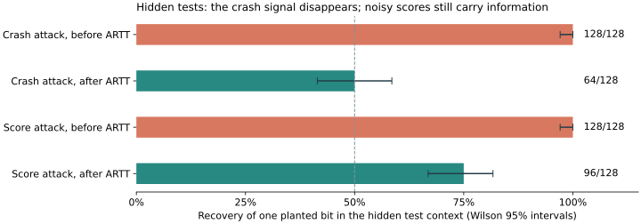

# A Right to Test: Public Evaluation Under Output Confidentiality

[Paper](https://doi.org/10.5281/zenodo.23180546) · [Paper source](paper/draft.tex) · [Coding demo and recorded results](demos/coding_agent/README.md) · [Evidence index](results/README.md)

Let outsiders run evaluations while protecting what the evaluator can read. This coding demo protects the **hidden test suite**: a malicious judge tries to publish one planted bit through a crash or a score. ARTT removes the crash signal, adds noise to scores, and charges each admitted release against a declared budget.



Crash bars are the paired live Qwen3-0.6B run. The exact-score baseline is a separately predeclared new cohort; the protected score bar retains the first live cohort. Whiskers are Wilson 95% intervals. The canary is a proxy bit in the private test context, not recovered test assertions. All earlier rows remain in the report.

## Quick start: coding demo

On Linux or Windows through WSL, with Python 3.11+, GCC, `unshare` and `libseccomp.so.2`:

```bash
python3 -m venv .venv
.venv/bin/python -m pip install -r requirements-test.txt
.venv/bin/python -m rt.build_sandbox
make demo
```

Open `scratch/coding-demo/report.html`. The default uses deterministic fixture agents and needs no GPU or model download. Every run needs a fresh directory; use `make demo OUTPUT=scratch/coding-demo-next` for another run. Windows also has `scripts/demo.ps1`.

The [live model option](demos/coding_agent/README.md#optional-live-local-model) uses local Qwen3-0.6B to produce patches. The custodian appends hidden tests after generation; the malicious judge sees them. The [repeated-filings experiment](demos/coding_agent/README.md#exact-score-baseline-and-repeated-filings) replays frozen public Qwen patches to isolate repeated releases: uncapped recovery reaches 128/128 at 16 filings; ARTT stops releasing scores after four per secret, with 109/128 recovery and 1,536 later refusals. Protected replay calls stay at 512. This curve makes no new GPU generations; its separate exact baseline generated 128 fresh patches.

## What the result means

Before ARTT, the judge crashes for bit 1 and succeeds for bit 0. Public error status reveals the bit. ARTT publishes the same scheduled record shape in both cases. The status decoder always guesses 0, and the balanced sample has 64 zeros: **64/128 is exactly half by construction**. For this crash attack, both branches also have identical raw scores and therefore identical noisy score distributions.

The deliberate score attack still leaks. At the demo's noise setting, each admitted two-score record costs **ε = 2 ln 3 ≈ 2.1972**. Refusals cost zero additional release epsilon. The budget limits the number of releases an attacker can combine; the ledger records the cost and detects editing. A retained checkpoint is needed to detect deletion of a final row. Large experimental caps are not strong privacy settings.

The coding runs historically used one shared counter, raised from 352 to 2,656, then 2,960, then 3,472 by committed protocols. The [accounting note](demos/coding_agent/README.md#privacy-accounting-and-policy-history) shows separate model attribution and all three cap raises without changing those original records. Separate model attribution does not create independent allowances for the same protected test suite.

The first fixture utility interval includes zero. A separately predeclared utility-only follow-up used 1,152 admissions per fixture and measured A minus B as 0.3524, with a conservative 95% interval of 0.1827 to 0.5222. It concerns the fixed 48-task corpus and repeated release noise. The learned-model run has only one model and makes no A/B utility claim.

## FAQ

**Why not just pre-approve the code?** Approval is useful if the custodian trusts a fixed evaluator. Public testing allows outsiders to submit new evaluations, so approval must account for what arbitrary code does after seeing private information, including secret-dependent crashes and scores. The sandbox restricts execution; the release interface separately restricts what can leave it. This demo shows why a small verdict alone is insufficient.

**Can two accounts split a secret?** They can combine their observations, so the custodian must charge them to the same protected scope. Budgets must be shared across accounts and program aliases, keyed to the protected asset and committed model snapshot. If multiple model paths access the same hidden tests, those paths need shared asset accounting too. Giving each account a fresh cap would break the intended protection.

**Was this a real problem?** The crash and score leaks ran through actual evaluators and a Linux sandbox, with real local Qwen-generated patches in the learned-model experiment. The secret was a synthetic canary planted by the custodian. This demonstrates a reproducible failure of an evaluation interface; it does not document a production breach or stolen proprietary tests. The custodian, isolation and delivery are trusted, and timing noninterference is not proven.

## Verify and explore

```bash
PYTEST_DISABLE_PLUGIN_AUTOLOAD=1 .venv/bin/python -m pytest -q -p no:cacheprovider
.venv/bin/python -m tools.research_audit --output scratch/recheck.json
```

The [evidence index](results/README.md) also covers the earlier learned-model study, multi-bit score study, privacy and utility calculations, and integrity audits. Its [interrupted-run limitation](results/multibit-rerun-2026-10-07/EVIDENCE-LIMITATIONS.md) remains part of the record. Counts and intervals belong to their declared cohorts; they are not pooled across experiments.

- `demos/coding_agent/`: coding tasks, fixture and local-model runners, protocols and report generation.
- `rt/`: isolation, release, logging and budget code.
- `judges/`, `examples/`, `fixtures/`: executable study inputs.
- `tests/`, `tools/`: regression checks and evidence audits.
- `paper/`, `results/`: paper, proofs, figures and retained research evidence.

Cite using [CITATION.cff](CITATION.cff). Code is [Apache 2.0](LICENSE); the paper is [CC BY 4.0](paper/LICENSE). Release source archives follow `.gitattributes`; generated PDFs, environments and scratch outputs are excluded. The compiled paper is distributed separately.
