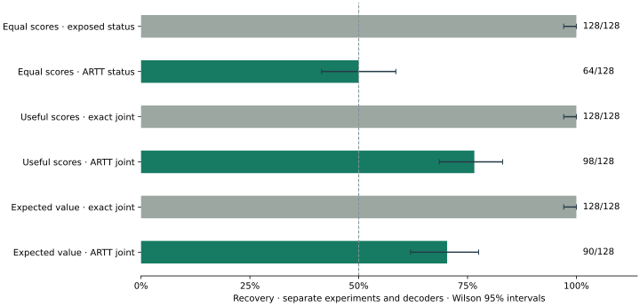

# A Right to Test: Public Evaluation Under Output Confidentiality

[Paper](https://doi.org/10.5281/zenodo.23180546) · [Paper source](paper/draft.tex) · [Coding demo](demos/coding_agent/README.md) · [Evidence index](results/README.md)

ARTT proposes a public, accountable process for independent AI testing under confidentiality: an outsider files an inspectable evaluation, a custodian executes it against a committed model configuration, and a publisher releases a bounded result under declared limits. The coding study protects the **hidden test suite** from a malicious judge that encodes a private suite choice in a crash or score.

## What ARTT contributes

- **A public filing contract:** executable methods, declared resources and result schemas, model commitments, admissions and refusal records.
- **An adversarial release model:** scores, crashes and timeouts can carry private information even when execution is sealed.
- **Controlled disclosure:** successes and failures share a scheduled, noisy interface, with access charged before execution and shared caps on repetition.
- **Checkable evidence and measured limits:** committed protocols, ledgers, checkpoints and source snapshots, alongside attack recovery and honest utility.

Building on confidential execution, differential privacy and covert-channel defenses, ARTT could broaden who can challenge AI claims; practical privacy settings, institutional adoption and frontier deployment remain future work. [Read the contribution and impact explanation](paper/public-note.md).

## What the coding study shows



The predeclared expected-value experiment protects **which valid expected value a hidden assertion checks**. Recovery falls from **128/128 to 90/128 (70.3%)** after one ARTT release, reaching **101/128 (78.9%)** after four: useful scores still leak after error status is hidden.

The optimal equal-score control falls from **128/128 to 64/128** when successful and fallback scores have identical distributions. The earlier assertion-order case falls from **128/128 to 98/128**; each experiment has its own cohort and decoder.

[Combined report](https://siddakbath.github.io/artt-protocol/results/coding-expected-value-2026-10-12/report/report.html) · [Detailed results and honest utility](demos/coding_agent/README.md#expected-value-secret-and-honest-utility)

## Quick start: coding demo

On Linux or Windows through WSL, with Python 3.11+, GCC, `unshare` and `libseccomp.so.2`:

```bash
python3 -m venv .venv
.venv/bin/python -m pip install -r requirements-test.txt
.venv/bin/python -m rt.build_sandbox
make demo
```

Open `scratch/coding-demo/report.html`. The default uses deterministic fixtures and needs no GPU or model download. Every run needs a fresh directory; use `make demo OUTPUT=scratch/coding-demo-next` for another run. Windows also has `scripts/demo.ps1`.

[Live model option](demos/coding_agent/README.md#optional-live-local-model) · [Exact baseline and repeated filings](demos/coding_agent/README.md#exact-score-baseline-and-repeated-filings)

## What the result means

At the current noise level, **ARTT meters the channel rather than making one bit private**. The expected-value experiment has a fixed 704-admission allowance and a four-release cap costing **ε = 8.7889 per secret**, conditional on isolated private contexts and the defined score/status interface; timing is excluded. Historical charges are retained, and the full research transcript is non-private. See the [demo README](demos/coding_agent/README.md) for honest utility, repeated-access results, privacy accounting and scope.

## FAQ

**Why not just pre-approve the code?** Approval helps with a fixed evaluator. Public testing admits new methods, so the release interface must also control what arbitrary code can disclose after reading private information.

**Can two accounts split a secret?** Their observations compose. Accounts, program aliases and models that access the same protected secret need shared asset accounting.

**What confidential information could this expose?** A hidden assertion's expected value or inclusion can reveal a benchmark's boundary cases. See the [expected-value study](demos/coding_agent/README.md#expected-value-secret-and-honest-utility) and [results report](https://siddakbath.github.io/artt-protocol/results/coding-expected-value-2026-10-12/report/report.html).

Run regression checks with `PYTEST_DISABLE_PLUGIN_AUTOLOAD=1 .venv/bin/python -m pytest -q -p no:cacheprovider` and the read-only evidence audit with `.venv/bin/python -m tools.research_audit --output scratch/recheck.json`. The [evidence index](results/README.md) covers the earlier studies and their limitations.

Cite using [CITATION.cff](CITATION.cff). Code is [Apache 2.0](LICENSE); the paper is [CC BY 4.0](paper/LICENSE). Source archives exclude generated PDFs, environments and scratch outputs; the compiled paper is distributed separately.
