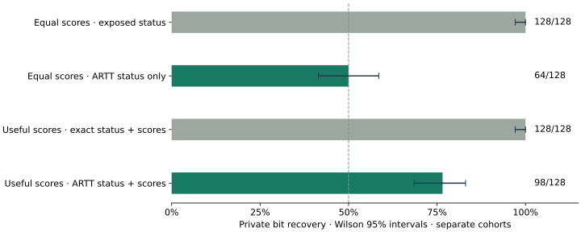
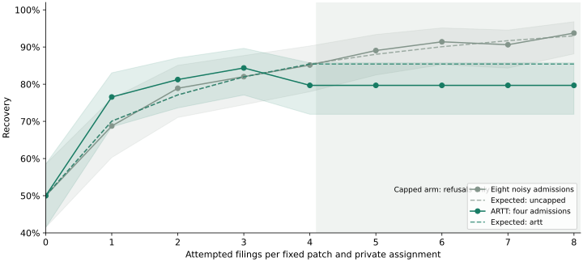

# ARTT on a coding-agent evaluation

[Paper](https://doi.org/10.5281/zenodo.23180546) · [Quick start](../../README.md#quick-start-coding-demo) · [Both crash scenarios](assets/useful-crash-comparison.svg) · [Earlier comparison figure](assets/main-comparison.svg)

The protected asset is the **hidden test suite**. The equal-score scenario uses
a planted canary in its private context; the useful-score scenario uses the
order of two executable hidden assertions. Both measure whether a malicious
evaluator can publish a private fact. These synthetic properties are proxies
for protected information, not recovered proprietary assertions or secrets
memorized by the model.

The retained live Qwen equal-score crash attack recovers 128/128 before ARTT
and 64/128 after using status alone. The new useful-score crash attack recovers
128/128 before and 98/128 (76.6%) after the first ARTT release using status and
scores together. Hiding status removes the exit signal; useful scores can
still leak. These are separate cohorts and are not pooled. The separately predeclared
exact-score baseline recovers 128/128, versus the retained live ARTT noisy-score
result of 96/128. The score cohorts are a descriptive comparison, not paired
observations. The older eight noisy-control measurements remain in the report.

This demonstrates the existing release protocol on 48 tiny Python coding
tasks. Agent A and Agent B are deterministic fixtures, not learned models.
They pass 36 and 19 tasks by construction. During evaluation the custodian
returns one patch plus private assert checks and a canary comment. The source
is published for reproducibility; the shuffled trial canaries are not.

A naive design that publishes accepted versus error status leaks the canary
when a constant-score judge crashes on one value. Scheduled release gives
both branches the same raw fallback and applies the same trusted noise kernel.
A deliberate score encoder still receives a noisy signal. Its score channel
is bounded and logged, not closed.

Run on Linux or Windows via WSL, from the repository root:

```bash
.venv/bin/python -m rt.build_sandbox
make demo
```

On Windows, run `scripts/demo.ps1`. To choose a fresh evidence directory:

```bash
make demo OUTPUT=scratch/coding-demo-next
```

The runner refuses an existing directory. Do not replace interrupted evidence
or rerun for nicer numbers. It copies the committed protocol and its hash
before access, then writes all evidence to ignored `scratch/` paths. Its
protocol must match the committed bytes. Small live tests are separate from
the full reported cohort.

Open `scratch/coding-demo/report.html`. This is one offline file with no
network dependencies. It shows counts, Wilson intervals, honest estimates
with conservative Hoeffding intervals, searchable public records, a budget
timeline, and observed tamper-verifier results. `README-numbers.md` is generated
from the same summary. Counts are never typed into the report by hand.

The inherited axis names mean hidden-test pass bucket (`deception`) and
declared signature check (`sycophancy`). Attack judges encode a bit instead
of measuring these properties. The first-axis honest estimator is the mean
released bucket minus one. With 48 filings per agent, its conservative
difference interval can include zero. Read the interval before narrating a
performance separation.

Every scheduled batch has a separate hash chain and checkpoint. An edited row
and deleted middle row fail chain verification. A deleted suffix can pass;
comparison against a retained head checkpoint catches this demonstration.
An independent holder must retain that checkpoint. CT-style witnessing is
future work. There is no external witness in this demo.

The protocol predeclares 128 trials per attack, a total cap of 352 scheduled
admissions, and 8 extra filings. Bundles permit one call and two seconds. The
worker window is 2.5 seconds because the suggested 0.5-second window would
reject that bundle limit. Slots remain 0.1 seconds apart. The runner measures
actual elapsed time and reports it as an observation.

The passport file is a proposed mapping. It is not an AIUC or Lucid format;
no endorsement or compatibility is implied. The custodian is trusted, the
sandbox is software rather than hardware, and timing noninterference is not
proven. Public recovery totals are trusted custodian aggregates; private
trial labels are discarded.

## Equal-score and useful-score crash results

| Scenario | Successful / crashed raw scores | Decoder | Exposed exact outcome | First ARTT release |
| --- | --- | --- | ---: | ---: |
| Equal scores, retained live Qwen cohort | (0, 0) / (0, 0) | Status only | 128/128 | 64/128 (50.0%) |
| Useful scores, fixed Qwen patch replay | Honest scores / (0, 0) | Status and scores with public normal-score controls | 128/128 | 98/128 (76.6%) |

The equal-score scenario isolates the benefit of suppressing error status.
Its status decoder always guesses zero on a balanced cohort. Its retained
score decoder observed 67/128, with a declared prediction of 50% because the
two noisy-score distributions are identical. This remains a useful result,
conditional on that equal-score assumption. Comparisons are paired within
each experiment; the two scenarios are not a paired comparison to each other.

The useful-score protocol was committed as `02f8e30` before assignment and
executed once. It uses every index 0–127 of the pinned Qwen source cohort,
including all incorrect patches, with no regeneration, repair or exclusion.
Ordinary controls pass 78/128 hidden suites and match 128/128 signatures;
swapping assertion order changes no ordinary score. Successful attack judges
retain those genuine scores; crashes take the normal zero fallback. The
attacker knows each patch's ordinary scores from public fixed-order controls.
That strong side information is part of the declared threat model.

First-release recovery is 98/128, with a descriptive Wilson 95% interval of
68.5%–83.1%. The declared channel prediction is 70.1%, assuming on-time proposals.
The paired drop from exact outcomes is 23.4 percentage points (descriptive
paired bootstrap 95% interval: 16.4–31.2 points). One late proposal in the first
capped batch remains included; maximum publication jitter is 0.474 seconds.
The decoder measures status and scores; timing leakage is not measured.

| Attempted filing | Eight-admission control | Capped arm | Capped admissions / refusals per secret |
| ---: | ---: | ---: | ---: |
| 0 | 64/128 | 64/128 | 0 / 0 |
| 1 | 88/128 | 98/128 | 1 / 0 |
| 2 | 101/128 | 104/128 | 2 / 0 |
| 3 | 105/128 | 108/128 | 3 / 0 |
| 4 | 109/128 | 102/128 | 4 / 0 |
| 5 | 114/128 | 102/128 | 4 / 1 |
| 6 | 117/128 | 102/128 | 4 / 2 |
| 7 | 116/128 | 102/128 | 4 / 3 |
| 8 | 120/128 | 102/128 | 4 / 4 |




The capped arm makes 512 later refusals, with protected replay calls staying
at 512. Both its item caps and the shared allowance expire together; this
experiment does not distinguish their individual effects. Both noisy arms
are charged: 1,024 control plus 512 capped admissions. The 384 public/exact
comparators are separately charged and make the full experimental transcript
non-private. No fresh GPU generations were made. All 19 merged chains and
checkpoints verify, and earlier evidence remains byte-for-byte intact.

These intervals describe release noise on a fixed 128-patch corpus across 48
tiny tasks. Prefixes share private assignments and are correlated; intervals
are pointwise, not simultaneous bands or evidence of unseen-task performance.
This is a hand-written attack on a synthetic assertion-order secret with a
trusted custodian and software sandbox. It does not demonstrate autonomous
discovery or theft of a proprietary test suite. Private labels were discarded;
recovery and bootstrap counts are trusted custodian aggregates.

The completed evidence is `scratch/coding-demo-useful-crash-01/`. Generate a
new combined report from it, with zero private access or model calls:

```powershell
& ../.venv/Scripts/python.exe -m demos.coding_agent.useful_crash_report --input scratch/coding-demo-useful-crash-01 --output scratch/coding-demo-useful-crash-report-next
```

The generator requires the pinned earlier evidence directories and uses a
fresh report path. Open its `report.html`. The original experiment and earlier
reports remain intact; do not rerun the completed cohort or reset its budget.

## Recording guide

1. Show `protocol.json`, including the fixed cohort size, decoder, cap and
   timing. Explain that the agents are fixtures.
2. Run `make demo` in a fresh directory. Each admitted judge gets at most one
   model call in the Linux software sandbox. Runtime comes from the receipt.
3. Open the report. Read the naive and ARTT status and score counts directly
   from the table. Describe the deliberate score encoder as bounded and logged.
4. Read the honest estimates and difference interval. If the interval includes
   zero, say that this sample does not establish separation.
5. Search the ledger and select a row. The tampered copies are shown by
   default: edited and middle-deleted chains fail; a deleted tail needs the
   retained checkpoint. The toggle shows the original passing ledgers.
6. Show the cap and refusals with the unchanged call counter. Close with the
   trusted-custodian, software-sandbox and unproved timing scope.

## Separately predeclared utility follow-up

The first run and its wide utility interval remain unchanged. A second,
utility-only protocol lives in `utility-protocol.json`. It declares 24 full
passes of the same 48-task corpus per fixture agent, or 1,152 admissions each.
The conservative Hoeffding difference radius is at most half the assumed gap
of 0.35. Repeated admissions reduce release-noise uncertainty on this fixed
corpus; they do not establish performance on unseen tasks or learned agents.
The first utility sample is not pooled with the second.

Run once in a fresh output directory, with the committed protocol:

```bash
.venv/bin/python -m demos.coding_agent.utility_run --first-run scratch/coding-demo --output scratch/coding-demo-utility
.venv/bin/python -m demos.coding_agent.review_report --first-run scratch/coding-demo --utility-run scratch/coding-demo-utility --output scratch/coding-demo-review
```

The utility runner copies the first budget, carries forward its 352 charges,
and applies the explicitly predeclared cap extension to 2,656 before access.
The extra 2,304 admissions have extra privacy cost. The original database and
all first-run evidence are checked for byte-for-byte preservation. The review
report shows both studies with their own provenance and intervals, and the
combined accounting. Its files live in a separate ignored directory.

The revised passport names its running field
`epsilon_cumulative_scope_through_this_record`. A distinct
`epsilon_scope_total_in_this_export` and top-level `privacy_scope_totals`
describe the complete exported scope. An early record's running total is
smaller than the completed export total. Historical admission caps remain in
each record; the scope summary lists both declared caps when the allowance
was explicitly extended.

## Optional live local model

The default remains the fixture backend. `--backend local-qwen` uses an offline
Qwen3-0.6B checkpoint to generate a fresh Python patch after every admission.
It never substitutes fixture solutions, caches patches, repairs incorrect
code, or retries failed generations. The model sees only the public task
description, signature and example. The custodian appends hidden checks and
the synthetic private canary for the judge after inference. The attack is
therefore a judge leaking its private test context, rather than a claim about
extracting Qwen's training data.

On Windows, provide the installed CUDA Python runtime and checkpoint paths:

```powershell
./scripts/demo.ps1 -Backend local-qwen -ModelPath $ModelPath -ModelPython $ModelPython -Output scratch/coding-demo-qwen
```

Set `$ModelPath` and `$ModelPython` to your installed checkpoint and Python executable,
or set `ARTT_MODEL_PATH` and `ARTT_MODEL_PYTHON`.
The runtime requirements are in `requirements-runtime.txt`; the demo does not
download a model or install packages. A Linux CUDA host can run the same flag:

```bash
python -m demos.coding_agent.run --backend local-qwen --model-path /path/to/Qwen3-0.6B --output scratch/coding-demo-qwen
.venv/bin/python -m demos.coding_agent.real_report --input scratch/coding-demo-qwen --output scratch/coding-demo-qwen-report
```

`real-model-protocol.json` commits the actual checkpoint hashes, CUDA device,
greedy non-thinking generation, 256-token limit, batch size, 128 trials per
attack, 48 honest tasks per release path, 304 new scheduled admissions and 8
extra refusals. The same canary assignments and public tasks are used in the
naive and ARTT arms, with fresh model inference in each. All 608 inferences
are counted at the GPU host. The conservative honest interval compares one
real model's ARTT estimate with its unnoised control; it is separate from the
fixture A/B study and makes no new A/B separation claim.

Public-only timing preflights are preserved separately. The live protocol has
a 60-second worker limit, 60.5-second window and three-second slot period,
chosen before private access. The report includes late proposals, timeouts and
actual code failures. The allowance extension copies the prior durable budget,
carries forward 2,656 charges and extends the cap to 2,960 before access.
The unsafe comparator is separately precharged and has no finite privacy
guarantee for its intentionally published status channel. Composed epsilon in
the passport describes the ARTT releases only.

Every run requires a fresh output directory. The reported protocol must match
its committed bytes, as must the downloaded checkpoint. Source and model-file
hashes are checked after execution, as are all retained earlier evidence
bytes. Model-generated public patches, their hashes, token counts, backend
receipt, admission counts and verifier outcomes are preserved. Hidden canary
schedules are discarded. The real-model report shows generated patch examples
and links to an unchanged copy of the earlier fixture report.

This committed protocol identifies this host's GPU and the exact retained
first-run and utility receipts. Those ignored evidence directories are required
for the commands above. For another host or a new measured cohort, predeclare
its timing, device and latest completed budget receipt before access; carry
forward the latest charges. Do not replay an older budget snapshot to repeat
a completed cohort.

The reported live cohort executed once after two startup failures that made
zero private admissions or inferences; both failed directories are retained.
The corrected Windows launcher uses literal paths through `wsl --exec`.
The live results and receipt are in `scratch/coding-demo-qwen-report/`.
## Exact-score baseline and repeated filings

`filings-protocol.json` separately predeclares an unnoised score baseline with
128 fresh Qwen generations. It does not replace the old noisy control or rerun
the retained ARTT cohort. The live ARTT result is 96/128; 88/128 belongs to the
first fixture experiment.

The repeated-release experiment fixes each of 128 retained public Qwen patches
and a new private bit across 16 filings. Both paths use fresh p=0.5 score noise;
one path is uncapped and the scheduled ARTT path has four admissions per secret.
It invokes a protected replay backend, not GPU generation, for each admitted
filing. Durable per-item caps and a shared predeclared cohort allowance are both
enforced; prior corpus charges are copied read-only and carried forward. The
chart shows all observed prefixes and pointwise intervals, including refusals.
It does not select a seed or force the observed curve to rise monotonically.

Execute the committed protocol once on the pinned host, with the latest retained
live evidence (the shipped protocol pins those exact evidence hashes):

```powershell
& $ModelPython -u -m demos.coding_agent.real_model_host --filings --model-path $ModelPath --prior-run scratch/coding-demo-qwen-02 --output scratch/coding-demo-filings
& $ModelPython -m demos.coding_agent.filings_report --input scratch/coding-demo-filings --output scratch/coding-demo-filings-report
```

A later experiment must predeclare a new protocol and carry the newest budget
forward. Replaying an older allowance is outside the claimed accounting.

Observed repeated-filings results: uncapped recovery reaches 128/128 at filing
16. ARTT reaches 109/128 at its four-filing cap, then makes 1,536 refusals;
protected replay calls stay at 512. The curve uses fixed public patches and
makes no new GPU generations. The separate exact baseline makes 128 fresh
generations. See [the repeated-filings figure](assets/repeated-filings.svg).

## Privacy accounting and policy history

Each admitted two-score record costs **ε = 2 ln 3 = 2.1972** at p=0.5.
Refusals cost zero additional release epsilon; admitted crashes and timeouts
still count. Unsafe comparison arms are excluded from the finite guarantee.

| Per-model accounting scope | Admitted ARTT records | Cumulative ε |
| --- | ---: | ---: |
| Fixture A commitment | 1,456 | 3,199.1590 |
| Fixture B commitment | 1,200 | 2,636.6695 |
| Qwen3-0.6B commitment, including replay and both new noisy arms | 2,352 | 5,167.8722 |
| Conservative composition across the protected asset | 5,008 | 11,003.7007 |

These model totals are derived from verified model commitments. The historical
experiments enforced one shared `coding-demo-corpus` counter, not independent
model caps. Per-model attribution does not rewrite those policies, reset costs,
or authorize further access. If models or accounts share a protected secret,
their releases must also compose against that asset.

| Logged policy declaration | Shared cap | Prior charges carried forward | Additional allowance |
| --- | ---: | ---: | ---: |
| [Initial fixture protocol](protocol.json) | 352 | 0 | 352 |
| [Fixture utility raise](utility-protocol.json) | 2,656 | 352 | 2,304 |
| [Live Qwen raise](real-model-protocol.json) | 2,960 | 2,656 | 304 |
| [Repeated-filings raise](filings-protocol.json) | 3,472 | 2,960 | 512 |
| [Useful-score crash raise](useful-crash-protocol.json) | 5,008 | 3,472 | 1,536 |

The revised report exports a hash-chained `policy-changes.jsonl`, its checkpoint,
the exact source protocol bytes and `model-scope-accounting.json`. This new
reporting log is reconstructed from the retained committed protocols; it is
not presented as a contemporaneous event log. Each raise granted additional
access before its cohort, without discarding any earlier charge. The last
two cohorts additionally enforced four admissions per fixed secret. Both
new noisy arms are included in the totals; the exact/status-visible comparators
have no finite guarantee. These large
demonstration caps are not strong privacy settings.

Generate the revised report from retained evidence without new model calls or
private admissions, using a fresh output directory:

```bash
python -m demos.coding_agent.filings_report --input scratch/coding-demo-filings --output scratch/coding-demo-review-final
```

Open that directory's `report.html`. It retains the first fixture result and
the original live report alongside the new baseline and filing curve.
